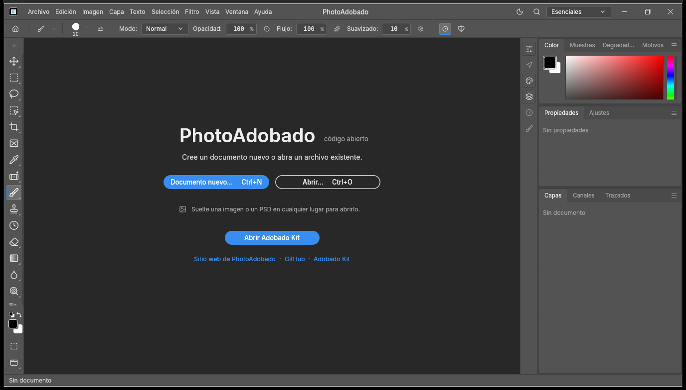
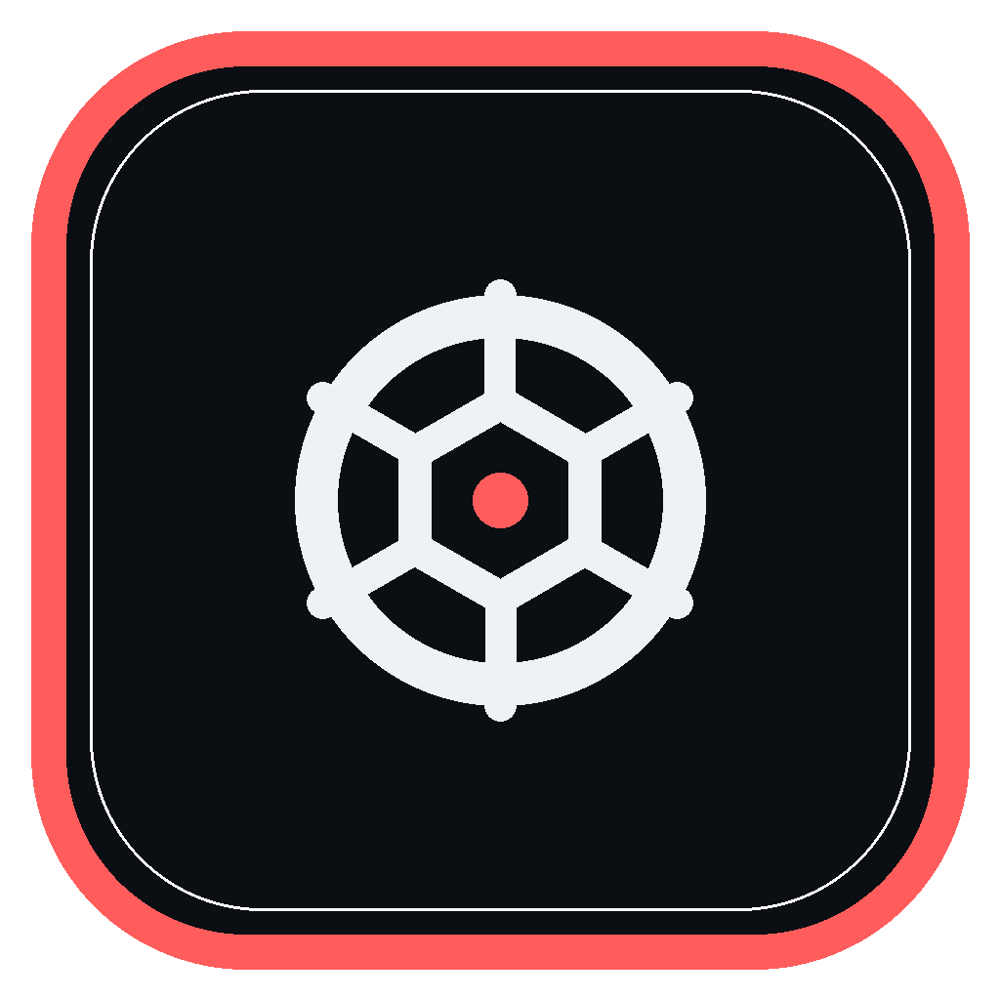

# PhotoAdobado

Editor de imagen nativo, local y open source. Derivado de PhotoCraft, rebrandeado para Adobado Kit.

> **Alpha temprana.** Es un derivado de un proyecto en desarrollo activo. No es un sustituto profesional de Photoshop ni una versión estable.
>
> Proyecto independiente. No está afiliado a Adobe ni a ArtCraft. Las marcas de terceros pertenecen a sus titulares.

## Qué incluye

- Capas, máscaras, grupos y estilos de capa.
- Ajustes no destructivos, curvas, niveles y color.
- Texto, vectores, pinceles y selecciones.
- Lectura y escritura de PSD, además de formatos de imagen habituales.
- Interfaz nativa en Rust con egui/wgpu; sin Electron ni webview.
- Funciona sin conexión y sin cuentas.

La lista completa de funciones y su estado están en la documentación upstream. La madurez es la de PhotoCraft: alpha.

## Build

Requisitos: Rust 1.95 o superior.

    cargo run --release -p photocraft -- imagen.psd

En Windows, el binario sale en target/release/photocraft.exe. El nombre interno del crate y del ejecutable se conserva para no romper el workspace; el nombre de producto visible es PhotoAdobado.

## Procedencia y licencias

- Upstream: https://github.com/storytold/photocraft
- Commit base: 03d0c7e3b39cfb401cdbba590431141ee4c6c8fa
- Código: MIT OR Apache-2.0. Se conservan LICENSE-MIT, LICENSE-APACHE, NOTICE y ATTRIBUTION.md.
- Cambios de esta distribución: docs/ADOBADO.md.
- La marca, el wordmark y los logos de ArtCraft son trademarks y se han retirado de esta distribución.

## Adobado Kit

PhotoAdobado forma parte de Adobado Kit: https://github.com/smouj/Adobado_Kit

Hecho por SMOUJ013.
